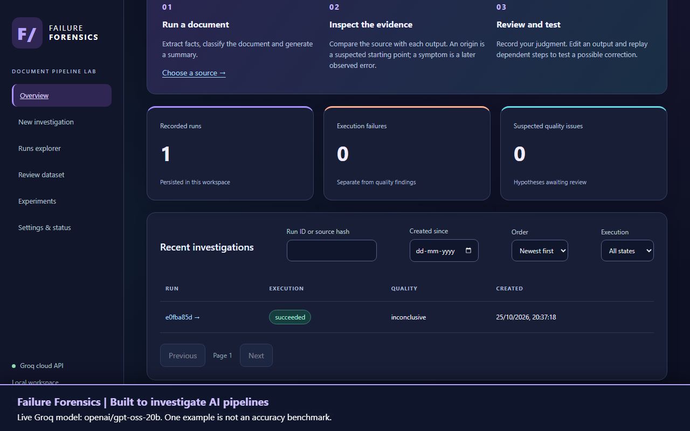
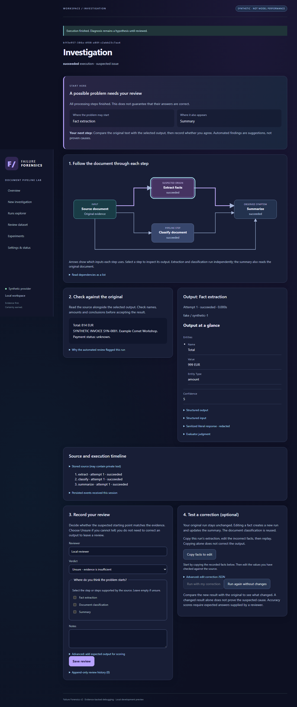

# Failure Forensics

A local document-pipeline investigation console: inspect truthful attempts, evidence-backed diagnosis hypotheses, human reviews and controlled replays. **Development preview, not production-ready.**

The v2 application lives in `ffv2/` and `frontend/`. Original pipeline modules remain available for compatibility and the legacy analyzer baseline. Original README: [legacy notes](docs/legacy-readme.md). Detailed acceptance gaps: [implementation status](docs/implementation-status.md).

## Watch the real AI walkthrough

[](https://github.com/PROGRAMMER-1008/FAILURE-FORENSIC-TOOL-FOR-AI-PIPELINE/blob/main/launch/failure-forensics-groq-demo.mp4)

[Watch or download the 62-second Groq video](https://github.com/PROGRAMMER-1008/FAILURE-FORENSIC-TOOL-FOR-AI-PIPELINE/raw/refs/heads/main/launch/failure-forensics-groq-demo.mp4). It uses a real Groq call with an invented invoice, with no injected error. Extraction returned **814 EUR** and classification returned **invoice**. The summary evaluator's citations failed validation, so the app kept the assessment **inconclusive**. One example is not an accuracy benchmark.

The repository now includes a **public, password-free mode** with isolated visitor workspaces. See [Vercel + Render setup](docs/public-deployment.md). This code release does not automatically switch the existing owner-only deployment.

The full application runs locally with your own Groq key or Ollama. The full single-owner app can be deployed using the [Render guide](docs/render-deployment.md). The [private hosted workspace](https://failure-forensics-project.onrender.com) was deployed on free Render hosting with Groq; see the readiness checklist for current verification limits. Owner sign-in is required. Free hosting sleeps when idle and its current database expires on 25 November 2026. See the [deployment readiness checklist](docs/deployment-readiness.md).

## Easy local setup (Windows)

For a fresh clone, install Git, [uv](https://docs.astral.sh/uv/getting-started/installation/) and Node.js 22.22.2. Then run from PowerShell:

```powershell
git clone https://github.com/PROGRAMMER-1008/FAILURE-FORENSIC-TOOL-FOR-AI-PIPELINE.git
cd FAILURE-FORENSIC-TOOL-FOR-AI-PIPELINE
uv sync --frozen
npm --prefix frontend ci
npm --prefix frontend run build
if (!(Test-Path .env)) { Copy-Item .env.example .env }
.\start-local.cmd
```

After first-time setup, double-click `start-local.cmd`. It loads your local configuration, migrates the selected database, and starts the API and worker. Open http://127.0.0.1:8001. Keep the terminal open; Ctrl+C stops the services. The default fake provider lets you explore without a key. Do not overwrite an existing `.env`.

When ready for real AI, edit `.env` locally:

```dotenv
FF_PROVIDER=groq
FF_GROQ_API_KEY=your-key-goes-here
```

Keep the configured producer/judge model identifiers or choose models available to your Groq account. Save and restart the launcher. Settings & status shows whether the key is present; presence does not mean authentication was verified. Missing-key mode allows browsing but blocks new AI work. Submitted content goes to Groq and uses your quota. Never send the key in chat or commit `.env`.

The launcher uses `data/local-ai.db` with the supplied template. The older synthetic and Groq preview databases remain intact. Process environment variables override file values. Direct API/worker commands below remain environment-only; use the launcher when you want `.env` support.

## Run locally without a GPU or API key

Prerequisites: uv, Python 3.12.10 (uv can install it), Node 22.22.2. Do not execute the old `forensic/` environment.

```powershell
uv sync --frozen
npm --prefix frontend ci
npm --prefix frontend run build
uv run python -m alembic upgrade head
uv run python -m uvicorn ffv2.api:app --host 127.0.0.1 --port 8000 --no-access-log
```

In a second terminal, from the repository root:

```powershell
uv run python -m ffv2.worker
```

Open [the local console](http://127.0.0.1:8000), choose **New investigation → Load invented invoice → Queue investigation**. The default fake provider deliberately supports synthetic mechanics, not arbitrary-document understanding. The sample's extraction can inject `999 EUR` while the source says `814 EUR`. Diagnosis identifies extraction as a suspected origin and summarization as an observed propagated symptom.

Review the diagnosis, optionally provide gold output, then re-execute with corrected extraction. The original remains intact; only affected descendants are rerun. No real-model quality or causal improvement is implied by this injected demonstration.

## Local Ollama

Install/run Ollama separately and provision your chosen model yourself. No model downloads happen during tests/builds.

```powershell
$env:FF_PROVIDER='ollama'
$env:FF_PRODUCER_MODEL='your-installed-model'
$env:FF_JUDGE_MODEL='your-installed-judge-model'
```

Set the same configuration in API and worker terminals before starting them. Source content is sent to the configured local Ollama endpoint. Same-model judging can have correlated errors. There is no cloud fallback. Real Ollama execution was not validated in this implementation session.

## What is implemented

- Versioned tracing envelopes, actual dependency graph, strict schema errors, sanitized literal responses, partial-run checkpoints.
- Canonical SQLAlchemy relational persistence and explicit Alembic migration; local SQLite and PostgreSQL queue support.
- Durable claims, leases/fencing, bounded retry, real SSE events, cancellation and idempotent submissions.
- React console with source/attempt/evidence inspection, append-only human reviews and re-execution interventions.
- Bounded document uploads including DOCX tables, parser isolation/deadline, source-context rejection rather than silent truncation.
- Dry-run legacy import, stable IDs, immutable feedback dataset snapshots, synthetic benchmark, SQLite backup/restore and deletion tooling.
- Hosted owner sign-in with revocable sessions, shared request budgets and Linux parser resource limits.
- Free Render combined web/worker and PostgreSQL Blueprint; read-only demo and optional trusted-proxy/OIDC boundaries.

## Verification



Screenshots contain only the invented sample. A [narrow-layout capture](docs/screenshots/investigation-narrow.png) is also available.

```powershell
uv run pytest
uv run ruff check
uv run ruff format --check
uv run mypy
uv run python scripts/scan_secrets.py
uv run python -m ffv2.benchmark
npm --prefix frontend run lint
npm --prefix frontend test
npm --prefix frontend run build
```

Browser tests require a running synthetic API/worker and Playwright Chromium. Disable shared-cache cleanup before installing:

```powershell
$env:PLAYWRIGHT_SKIP_BROWSER_GC='1'
npm --prefix frontend exec -- playwright install chromium
npm --prefix frontend run e2e
```

PostgreSQL tests require `FF_TEST_DATABASE_URL` pointing to a **disposable** database. They skip with a reason otherwise. SQLite tests do not establish PostgreSQL concurrency behavior. The session also ran the PostgreSQL claim/fencing test separately and built/smoke-tested a local container.

See [configuration](docs/configuration.md), [architecture](docs/architecture.md), [migration](docs/migration.md), [deployment](docs/deployment.md), [runbook](docs/runbook.md), [security](docs/security.md), and [evaluation](docs/evaluation.md).

No services have been published or deployed. Direct service commands do not auto-load `.env`; the explicit local launcher reads it when you run it. Supply process variables deliberately; never put secrets in frontend variables. No license has been selected on the owner's behalf.

## Groq cloud API

From a PowerShell terminal in this repository, run:

```powershell
.\.venv\Scripts\python.exe scripts/start_groq.py
```

The launcher asks for a model (default `openai/gpt-oss-20b`) and then your API key in a hidden prompt. It never reads .env or saves the key to a file; child processes receive it in their environment. Open http://127.0.0.1:8001 and keep the terminal open. Ctrl+C stops both services. The separate database is data/groq-preview.db; the synthetic preview on port 8000 is unaffected.

Submitting a document sends redacted text and intermediate outputs to Groq. A successful three-step run normally makes six calls (three generation, three evaluation); bounded retries may add calls. Account quotas and charges apply. Same-model evaluation may have correlated errors. JSON object mode is locally validated against the pipeline contracts; valid JSON is not a guarantee of correct facts or schema compliance. HTTP authentication/rate-limit/provider failures are sanitized as provider_error; there is no fallback. Live Groq acceptance has not been run without a user-configured credential.

For manual startup, set FF_PROVIDER=groq, FF_GROQ_API_KEY, FF_PRODUCER_MODEL and FF_JUDGE_MODEL in both process environments. Never put the API key in frontend variables or source files. The model must be available to your Groq account.

API reference: https://console.groq.com/docs/api-reference
Model availability: https://console.groq.com/docs/models
