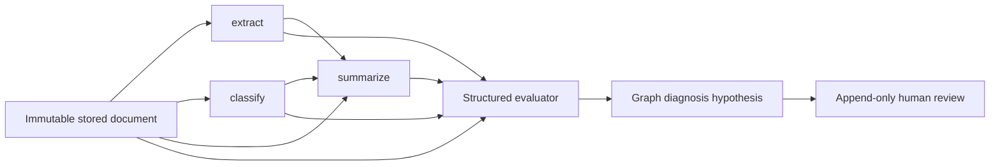

# Architecture

One API, one or more PostgreSQL workers, one relational database. SQLite is a single-worker local convenience. JSON is import/export and transactionally stored payload data, not a second file-based source of truth.

API submission inserts run, job and first event in one transaction. A PostgreSQL worker locks a claim with SKIP LOCKED, increments its generation and sets a lease. Every checkpoint locks and verifies owner/generation/lease before updating the run, attempts and event sequence. Model calls occur outside DB transactions. This is **at-least-once inference**: a crash can repeat a provider call. Stale owners cannot commit after recovery. Lease heartbeats happen between bounded calls; calls must finish before the lease expires.

Each attempt persists as running before inference and ends with output or an explicit technical error. Failed prerequisites skip dependent steps; independent classification may continue. Run quality is separate from execution. Missing/invalid judge responses are inconclusive, not pipeline-quality failures.

Judging receives original source, actual structured inputs and outputs with producer confidence/reasoning stripped. Source quote offsets are validated. Evidence supports a hypothesis, not proof. Propagation requires a validated upstream allegation, a real path and an explicit faithful-input inheritance assertion. No cache is implemented, so there is no cross-document cache reuse.

Reviews are append-only and revision-aware. A repeated idempotency key returns the original review. Conflicts withdraw mutable feedback cases but do not rewrite frozen historical snapshots. The UI can label a missed failure or no issue without requiring an origin already found by the analyzer. Explicit gold output is optional for diagnosis labeling but necessary for future output scoring.

Trust boundaries: browser text is untrusted; React escapes it. Uploads are bounded and parsed in a child process. Providers have no shell/tools. Operational logs/spans contain operation labels and durations, never source content. OpenTelemetry API spans are separate from stored user-pipeline attempts; exporting telemetry requires deployment configuration.

Tradeoffs: JSON payloads alongside normalized relational metadata ease versioning, but large run details still load full run payloads. Summary lists/stats select metadata only. Private hosting is single-owner, with maintained external OIDC proxy validation and strict peer/subject checks; multi-tenant ownership is not implemented. No distributed rate limiter or adaptive chunking is provided yet.
