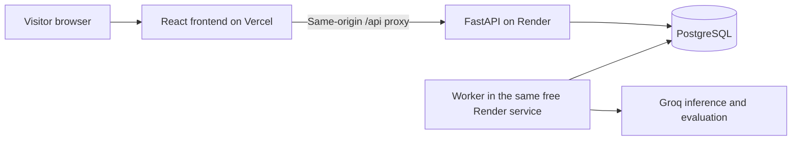

# Public version: Vercel frontend + Render backend

The repository supports `FF_MODE=public`: visitors open the app without a password or an API key. Each browser receives a random, Secure/HttpOnly/SameSite cookie. All runs, event streams, exports, reviews, comparisons, datasets and experiments are restricted to that visitor. Existing owner-mode records have no visitor identity and remain inaccessible through public mode.

## Architecture

The frontend uses relative `/api` URLs. Root `vercel.json` forwards those requests to Render, including cookies, without exposing the Groq key. API responses explicitly disable browser/CDN caching. No cross-origin browser credentials or wildcard CORS configuration is required. Preview domains are not automatically trusted for writes.

## Deploy your own copy

1. Fork this GitHub repository. Configure the backend using root `render.yaml`, or reuse an existing service/database. Do not create a duplicate database when one already exists.
2. Keep the backend Docker command `python -m ffv2.hosted project`. Set `FF_MODE=public`, the internal PostgreSQL URL as `FF_DATABASE_URL`, and your Groq key as `FF_GROQ_API_KEY` in Render environment settings. Never put secrets in Git, Vercel frontend variables, or browser forms.
3. Set `FF_PRODUCER_MODEL` and `FF_JUDGE_MODEL` to models enabled in your Groq account. The supplied configuration uses `openai/gpt-oss-20b`.
4. Edit the non-secret backend URL in root `vercel.json` to your Render service URL. Import the repository into Vercel with the **repository root** as its root directory. The file configures the frontend install/build/output and API rewrite. No Python backend runs on Vercel.
5. Set Render's `FF_PUBLIC_ORIGIN` to the exact public Vercel HTTPS URL, with no trailing slash (for example `https://your-project.vercel.app`). Redeploy the backend after saving settings. The Groq key stays on Render. `FF_OWNER_PASSWORD_HASH` is not needed for public mode.
6. Verify in two separate browser profiles: submit in one; confirm the second cannot list or open its run/export. Confirm API responses have `Cache-Control: private, no-store` and the visitor cookie is Secure/HttpOnly. Test a real Groq submission and export after a restart before announcing the URL.

The public mode can also run entirely on Render: set `FF_PUBLIC_ORIGIN` to the Render HTTPS address and use the built-in frontend. Vercel is optional, not an authentication requirement.

## Access and resource limits

- A visitor session lasts 24 hours by default (`FF_VISITOR_SESSION_SECONDS`). It is not an account: clearing cookies, changing browsers or expiry loses access. Download results before leaving. Expired access does not automatically delete database records; operators remain responsible for retention/deletion.
- Default allowance: 3 submission attempts per visitor and 20 shared attempts per UTC day. Runs, uploads, replays and experiments count, even rejected attempts or repeated idempotent requests. These conservative reservations are not refunded. Configure with `FF_VISITOR_DAILY_SUBMISSIONS` and `FF_PUBLIC_DAILY_SUBMISSIONS`.
- The shared daily Groq call limit remains 100 by default, including judge calls and retries. Failed calls can consume quota. Exhaustion or provider failures are shown explicitly; unavailable evaluation stays inconclusive.
- Session creation has a shared limit of 200 per hour. Clearing cookies can bypass a per-visitor allowance, but cannot bypass the global submission or AI-call budgets. Anonymous access cannot guarantee one allowance per human. Forwarded IP/identity headers do not grant ownership or extra global quota.
- Global metrics are not exposed to public visitors. Private owner mode remains available by setting `FF_MODE=hosted` with its required owner hash.
- Free Render sleeps when idle, including its worker. Opening the site wakes the backend. Vercel does not eliminate that delay. Free Render PostgreSQL expires after 30 days; this project's existing database expires 25 November 2026. Export important results and plan continued storage separately. No paid provisioning is implied.

## Release status

Public mode and deployment configuration are delivered in the repository. The existing Render deployment remains in owner mode until the operator deploys this revision and switches the settings. The earlier Vercel sample is not automatically replaced by pushing this repository. Do not announce either old URL as the public version until the two-browser live checks pass.

Reference: [Vercel external rewrites](https://vercel.com/docs/routing/rewrites).
